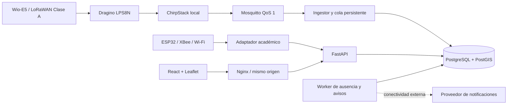

# GeoCattle V1: arquitectura implementada

La operación local requiere energía y LAN. No necesita Internet para consultar animales, guardar lecturas ni evaluar reglas. Los mapas de OpenStreetMap se activan opcionalmente: sin esa capa, los polígonos, posiciones y recorridos permanecen visibles sobre una cuadrícula local. El navegador necesita acceso al servidor para obtener nuevos datos; una desconexión de la API se presenta explícitamente.

## Límites y separación

- Los usuarios pertenecen a un predio y sus permisos se comprueban en cada operación del servidor. El predio de una solicitud procede de la sesión autenticada.
- La base de simulación se despliega en un proyecto Compose, volúmenes, credenciales y puertos separados del piloto. El origen `sim` y las rutas de simulación se bloquean fuera de simulación; la base de simulación rechaza fuentes de captura real. La demo académica real usa su propio ambiente development y base.
- Las lecturas son inmutables. El índice único dispositivo/sesión/secuencia elimina reentregas. Las asociaciones temporales atribuyen datos a quien usaba el collar en el momento de captura.
- PostgreSQL/PostGIS almacena la información del SaaS. SQLite, cuando se utiliza en ingestión/adaptador, almacena únicamente una cola de transporte recuperable.
- Geocercas WGS84 versionadas, geometrías válidas y borde incluido. Ediciones concurrentes usan versión esperada y retornan conflicto, sin sobrescribir silenciosamente.
- Las reglas preventivas de temperatura superficial y actividad se habilitan según parámetros verificados. Sus avisos solicitan revisión; no diagnostican enfermedades ni confirman abigeato.
- El backend añade `received_at`. Ni la edad de posición ni el timeout se rejuvenecen con duplicados o paquetes de captura anterior.
- Atención humana y condición técnica son independientes. Los intentos externos preservan el evento local y distinguen aceptación del proveedor de lectura humana.

## Servicios de ejecución

La base, migración, API, worker y frontend constituyen el despliegue local principal. El perfil `iot` añade broker e ingestor. El perfil `lorawan` incorpora ChirpStack, Redis y su base independiente, y se utiliza conjuntamente con `iot`. El equipo físico, claves OTAA, codec binario, gateway y downlinks requieren aprovisionamiento y validación en banco; arrancar esos servicios no demuestra comunicación real.

No se incorporan cobros, pasarela de pagos ni planes comerciales: el informe define supervisión predial y contratos por validar, y no especifica esos flujos de producto.

Fuentes técnicas consultadas: [FastAPI seguridad](https://fastapi.tiangolo.com/tutorial/security/), [PostGIS ST_Covers](https://postgis.net/docs/ST_Covers.html), [React](https://react.dev/learn), [Leaflet](https://leafletjs.com/reference.html), [ChirpStack MQTT](https://www.chirpstack.io/docs/chirpstack/integrations/mqtt.html), [Docker PostGIS](https://github.com/postgis/docker-postgis). Los requisitos funcionales provienen del segundo informe local y están trazados en REQUISITOS_INFORME_2.md.
