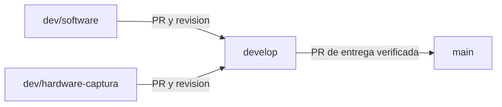

# Desarrollo colaborativo de GeoCattle

Fecha: 29 de octubre de 2026. Repositorio: `noagame/GeoCattle`.

La separacion organiza el trabajo de Boris (`@BorBP`) y Fabian Del Villar (`@noagame`) mediante ramas y revision. Conserva las carpetas existentes y el historial de Git. No requiere otro repositorio, cambiar el nombre del proyecto, duplicar modulos ni mover funciones de la aplicacion.

## Ramas y recorrido de integracion

| Rama | Uso | Coordinacion |
|---|---|---|
| `main` | Version estable y entregas revisadas | Ambos |
| `develop` | Integrar y verificar los cambios compatibles | Ambos |
| `dev/software` | Interfaz, API, reglas, mapas, geocercas, alertas y gestion | Fabian como referencia; Boris tambien puede trabajar aqui |
| `dev/hardware-captura` | Captura USB, receptores, gateways y compatibilidad de telemetria | Boris como referencia; Fabian tambien puede colaborar |



Si Boris ajusta una pantalla o un endpoint para completar la captura, puede incluir ese ajuste en `dev/hardware-captura`; no tiene que cambiar de rama solo porque el archivo pertenezca al software. Del mismo modo, Fabian puede adaptar el contrato desde su rama de software, coordinandolo con Boris. Para tareas independientes pueden crear `feature/borbp/TAREA` o `feature/noagame/TAREA` desde `develop` y abrir un PR hacia `develop`.

Los nombres de las ramas indican el area, no permisos exclusivos. Los dos integrantes pueden modificar software. Conviene acordar quien toma cada tarea antes de editar el mismo modulo. Las ramas `dev/*` son reutilizables: no borrarlas automaticamente despues de un PR sin acordarlo.

Los cambios de captura que aun estan en desarrollo deben permanecer identificados como borrador en `dev/hardware-captura`, con sus pendientes de validacion. Conservarlos en Git no significa desplegarlos ni darlos por integrados en `main`.

## Areas sin mover carpetas

| Area | Rutas existentes | Coordinacion principal |
|---|---|---|
| Aplicacion | `frontend/`, `backend/geocattle/`, `backend/tests/` | Fabian y Boris |
| Captura fisica | `adapters/`, `scripts/start_capture.py`, `scripts/export_usb_day.py`, accesos `Iniciar-Captura*` y `Pausar-Captura*` | Boris |
| Pruebas del contrato y receptores | `qa/test_capture_*`, `qa/test_serial_receiver.py`, `qa/test_lora_*`, `qa/test_esp32_contract.py`, `qa/test_academic_bridge.py` | Ambos |
| Persistencia y despliegue | `database/`, `infrastructure/`, `compose*.yaml`, scripts de arranque y respaldo | Ambos |
| Diseno y evidencias | `docs/`, `README.md`, `resumen.md` | Ambos |

La responsabilidad principal es un acuerdo de trabajo. `CODEOWNERS` incluye a ambos para permitir que el otro integrante revise el PR, tambien cuando el autor es quien suele mantener esa area.

## Contratos que deben coordinarse

- `backend/geocattle/schemas.py`: `TelemetryIn` y contrato API.
- `backend/geocattle/main.py`: `POST /api/v1/ingest/telemetry`.
- `backend/geocattle/hardware_api.py`: consultas de telemetria y estado del receptor.
- `adapters/lora_json.py`, `adapters/lora_usb.py` y los decodificadores de lotes cuando formen parte del cambio: normalizacion desde el formato fisico al contrato API.
- `frontend/src/HardwarePage.tsx`, `TelemetryView.tsx`, `api.ts` y tipos compartidos: presentacion de datos y estado.
- `database/migrations/`: evolucion del esquema. Una migracion ya aplicada se extiende mediante una nueva migracion; no se cambia silenciosamente su historia.
- `compose*.yaml`, `scripts/prototype_windows.py`, `scripts/docker_project.py`, `scripts/local_backend.py` e `infrastructure/`: arranque, puertos, servicios y entornos.
- `docs/CONTRATO_API.md`: documentacion del contrato que comparten software y captura.

El `v` del paquete LoRa y el `schema_version` de la API son versiones diferentes. Un cambio de formato debe conservar las versiones admitidas o documentar su migracion, y probar el emisor/receptor y el adaptador afectados. No modificar el contrato solo en uno de los extremos.

La identidad de lectura por collar, sesion y secuencia, la ausencia de coordenadas cuando no hay fix, y la distincion entre fecha observada y recibida deben mantenerse. No reatribuir lecturas historicas para resolver un cambio de interfaz o transporte.

## Actualizar una rama sin borrar el trabajo del otro

Desde un checkout limpio de trabajo:

```text
git status
git fetch origin
git switch dev/hardware-captura
git merge --ff-only origin/dev/hardware-captura
git merge origin/develop
```

Para software, usar `dev/software` en los dos comandos de rama. Si la actualizacion rapida falla porque existen commits propios y remotos diferentes, revisar la divergencia y unir los historiales mediante merge; no forzar la rama ni descartar cambios.

Al terminar una tarea:

```text
git status
git diff
git add RUTAS_REVISADAS
git commit -m "Describir problema y comportamiento final"
git push origin dev/hardware-captura
```

`RUTAS_REVISADAS` es un marcador que debe sustituirse por archivos concretos. Revisar lo incluido con `git diff --cached` antes del commit. Abrir el PR hacia `develop` y usar su plantilla. Para que ambos trabajen a la vez, cada persona usa su propia clonacion o un worktree independiente; no compartir el mismo directorio abierto en ramas distintas.

Si hay un conflicto, comparar las dos intenciones y conservar ambos comportamientos cuando corresponda. No usar una sustitucion completa de carpeta ni aceptar automaticamente todo "ours" o "theirs". Ejecutar nuevamente las comprobaciones afectadas despues de resolverlo.

## Revision y protecciones de GitHub

Tras la primera ejecucion correcta del workflow, el propietario `noagame` debe activar las reglas en [Settings / Rules](https://github.com/noagame/GeoCattle/settings/rules). Para `main` y `develop`, se recomienda exigir PR, una aprobacion del otro colaborador, conversaciones resueltas y los checks de CI correctos; impedir borrado y force push de esas ramas. Mantener merge commits permitido, porque este flujo conserva los dos historiales sin reescribir ramas compartidas.

Los nombres estables de los checks son:

- `geocattle-frontend`
- `geocattle-captura-contratos`
- `geocattle-reglas-dominio`
- `geocattle-backend-postgis`

Los archivos del repositorio definen CODEOWNERS, la plantilla y el workflow. **Las restricciones obligatorias de merge se activan por separado en la configuracion de reglas/proteccion de GitHub** y requieren permisos suficientes; no se deben dar por activadas solo por existir estos archivos. CODEOWNERS debe estar en la rama destino para que GitHub lo use en su revision.

Con dos integrantes, pedir dos aprobaciones obligatorias impediria integrar el PR de uno de ellos. CODEOWNERS con dos propietarios acepta la revision de cualquiera; no exige la aprobacion de ambos. El acuerdo es que revise el integrante que no es autor del PR. Los borradores no representan una solicitud automatica de revision final.

Referencias: [CODEOWNERS](https://docs.github.com/en/repositories/managing-your-repositorys-settings-and-features/customizing-your-repository/about-code-owners) y [proteccion de ramas](https://docs.github.com/en/repositories/configuring-branches-and-merges-in-your-repository/managing-protected-branches/about-protected-branches).

## Verificaciones y limites

El workflow se ejecuta en PR y en las ramas de desarrollo e integracion indicadas, sin filtrar por carpeta. Un cambio pequeno de interfaz tambien puede afectar al contrato, por lo que se ejecutan los cuatro checks.

- Frontend: `npm ci`, pruebas de geocercas declaradas en `npm test` y compilacion de React/TypeScript.
- Captura y contrato: suites de formatos, cola, identidad USB, configuracion de arranque y portabilidad, con fixtures y servicios HTTP temporales.
- Extensiones de captura: si la rama incluye pruebas nuevas de lotes, perfiles o alternancia, se ejecutan tambien; un borrador que falla debe corregirse antes de integrarlo.
- Dominio: `backend/tests/test_rules.py`, con reglas, validaciones y cola temporal; no requiere PostgreSQL real.
- Backend y PostGIS: servicio temporal PostgreSQL 16/PostGIS 3.4 por ejecucion, migracion desde cero, segunda ejecucion de migraciones y toda la suite `backend/tests`. Incluye CRUD de gateways, permisos, aislamiento entre predios, archivo e historial. Usa exclusivamente credenciales descartables de CI, sin secretos ni base operativa.

La CI no abre puertos COM ni usa la base operativa. Tampoco valida cobertura LoRa, autonomia, carga real ni nuevas modalidades de receptor que sigan en borrador. Los cambios de esquema, permisos y endpoints deben ampliar las pruebas de integracion en la base PostgreSQL/PostGIS temporal y consignar el resultado en el PR. Las nuevas restricciones de merge, incluido exigir `geocattle-backend-postgis`, deben configurarse por separado en GitHub; declarar el job no activa una proteccion obligatoria.

Separar ramas evita mezclar cambios sin revision, pero no garantiza por si mismo el rendimiento. Si se modifica el volumen de lecturas, consultas o renderizado de mapas, el PR debe indicar la comprobacion pertinente y sus limites.

Una rama tampoco aisla procesos, puertos ni bases locales. Los archivos `.env*`, `.runtime/`, capturas, colas y credenciales siguen fuera de Git. Para ejecutar dos instalaciones simultaneas, usar entornos, directorios de datos y puertos separados segun la documentacion operativa; cambiar de rama no realiza esa separacion automaticamente.

## Estado inicial preservado

La separacion parte de `b477a0d`, que incluye los dos commits nuevos de Fabian sobre el modelo Blender y las correcciones de geocercas/alertas. El trabajo local de captura se guardo primero en `7285fd8` y se conserva en su rama antes de reunir el historial comun. La etiqueta `respaldo-2026-10-29` identifica la version estable remota anterior a la separacion.

La validacion local de la base comun aprobo 63 pruebas de captura/contratos/portabilidad, 7 de dominio y 4 de geocercas; TypeScript y Vite compilaron. No se ejecutaron pruebas de campo ni migraciones sobre la base operativa como parte de esta reorganizacion. GitHub Actions debe comprobar tambien cada commit que se publique.

`Publicar-Ramas.cmd` publica exclusivamente las tres ramas de desarrollo y la etiqueta de respaldo mediante un push atomico, sin incluir `main`. Es util cuando el entorno de automatizacion no puede acceder a las credenciales de Windows. Requiere la cuenta colaboradora y no guarda tokens ni contrasenas en los archivos del proyecto.
