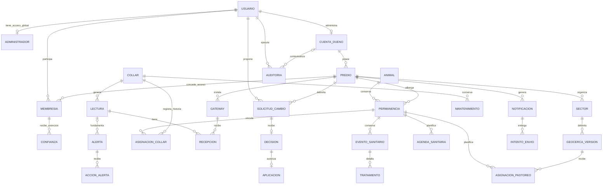

# GeoCattle V3 — Modelo conceptual entidad-relación

Este nivel describe conceptos y cardinalidades de negocio, sin UUID, tipos PostgreSQL, PK ni índices. El diagrama lógico separado muestra su transformación a tablas.

## Cardinalidades y participación

| Relación | Cardinalidad | Interpretación |
|---|---|---|
| Usuario – cuenta de dueño | 1 : 0..1 | Cada cuenta tiene un dueño principal; un usuario puede no ser dueño. |
| Cuenta – predio | 1 : 0..N | Cuenta recién creada puede no tener predios; cada predio tiene una cuenta. |
| Usuario – predio | N : M mediante membresía | Trabajadores/veterinarios pueden colaborar en varios predios; dueño accede mediante su cuenta. |
| Predio – sector – geocerca versión | 1:N y 1:N | Sector estable; geometría cambia mediante versiones temporales. |
| Animal – predio | N:M histórica mediante permanencia | A lo sumo una permanencia activa por animal. |
| Animal – collar | N:M histórica mediante asignación | En un instante, a lo sumo un collar por animal y un animal por collar. |
| Animal – geocerca | N:M histórica mediante pastoreo | Una geocerca vigente por animal; varios animales simultáneos por geocerca. |
| Collar – lectura | 1:0..N | Cada lectura proviene de un collar, aunque no tenga animal atribuido. |
| Lectura – gateway | N:M mediante recepción | Un uplink puede recibirse por varias antenas. |
| Solicitud – decisión – aplicación | 1:0..1 y 1:0..1 | Pendiente no tiene decisión; rechazada no tiene aplicación; aceptada/directa exige aplicación. |
| Permanencia – evento sanitario – tratamiento | 1:N y 1:N | Historia sanitaria contextualizada y varios productos posibles. |
| Agenda – evento sanitario | N:0..1 por entrada completada | Planificar no demuestra administrar; completar exige evento real del mismo animal. |

El diagrama omite conceptos de soporte (retos, factores, proyecciones, métricas y configuración) para mantener el nivel conceptual. La extensión FMA conserva relación documento N:M animal mediante detalle, definida en el modelo lógico. Ninguna cardinalidad por sí sola demuestra autorización o ausencia de solapamientos.
