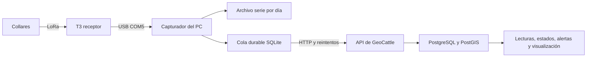

# GeoCattle: almacenamiento diario, histórico y rendimiento

**Fecha:** 22 de octubre de 2026, America/Santiago.
**Alcance:** revisión del código y consulta de solo lectura de la base del prototipo.
**Estado:** propuesta técnica; no se han cambiado tablas, retenciones, firmware ni servicios durante esta revisión.

## 1. Recomendación

**Sí conviene distinguir los datos recientes de los históricos, pero cada lectura debe quedar guardada de forma durable al recibirla.** No recomiendo mantener todo el día únicamente en memoria ni esperar a medianoche para persistirlo en PostgreSQL.

Para GeoCattle recomiendo conservar PostgreSQL/PostGIS como base principal y aplicar estas etapas:

1. Guardar inmediatamente las capturas en la cola local y entregarlas a PostgreSQL, como ya hace el prototipo.
2. Consultar el estado actual y las lecturas recientes mediante consultas acotadas e índices adecuados.
3. Mantener resúmenes por intervalos y por día para gráficos, indicadores e informes.
4. Incorporar particiones temporales e histórico comprimido cuando el volumen medido lo justifique, preservando las relaciones con animales, alertas y asignaciones.

Con 70 collares enviando cada 15 segundos, el promedio sería **4,67 mensajes por segundo y 403.200 lecturas diarias**. Esa tasa no demuestra por sí sola que el servidor vaya a bloquearse. Importan también las consultas, los índices, las transacciones, el disco, la acumulación del histórico y el trabajo realizado por cada mensaje. El crecimiento anual sí merece una política explícita desde el diseño.

**Prioridad inmediata:** optimizar los resúmenes y el capturador antes de crear un traslado nocturno de todos los registros. Cambiar una tabla por otra, conservando consultas que recorren todo el histórico, no soluciona el problema.

## 2. Situación comprobada en este proyecto

### 2.1 Flujo vigente



- `adapters/lora_usb.py` guarda las líneas recibidas en `serial.jsonl`, separadas por día chileno, y las capturas normalizadas en SQLite. Una captura se marca entregada después de obtener confirmación de la API.
- PostgreSQL guarda las lecturas en `telemetry`. La identidad `(device_id, session_id, seq)` evita insertar dos veces el mismo mensaje.
- Hay índices por dispositivo/fecha, animal/fecha y posición espacial, además de las restricciones de identidad.
- `devices` y `animal_states` ya mantienen referencias a estados recientes. Esto permite construir el panel actual sin cargar todo el historial.
- `telemetry` se relaciona con dispositivos, animales y asignaciones; también es referenciada por eventos, estados y recepciones de gateways.
- Las lecturas son inmutables: un trigger bloquea su modificación y eliminación, y el usuario de aplicación no tiene permisos de `UPDATE` ni `DELETE` sobre ellas.
- No encontré particionado temporal, una tarea de archivo histórico ni tablas persistentes de resúmenes en el flujo revisado. El resumen diario actual se calcula consultando las lecturas originales.

### 2.2 Medición del prototipo

Corte de solo lectura: **22/10/2026, 22:13:04, hora de Chile**.

| Indicador | Resultado |
|---|---:|
| Lecturas en `telemetry` | 85 |
| Dispositivos con lecturas | 1 |
| Capturas confirmadas en el estado del puente | 85 |
| Capturas pendientes en ese estado | 0 |
| Tamaño medio de fila mediante `pg_column_size` | 667 bytes |
| Datos de la tabla, sin índices | 73.728 bytes |
| Índices de `telemetry` | 90.112 bytes |
| Tamaño total de la relación, incluido almacenamiento auxiliar | 196.608 bytes |
| Tamaño total de la base | 20.061.207 bytes |

Son medidas de una base pequeña, no un ensayo de rendimiento. La asignación de páginas, índices y espacio auxiliar impide extrapolar de forma precisa dividiendo estos tamaños entre 85. Tampoco se ha medido aquí la capacidad del PC con 70 collares, usuarios concurrentes o un año de información.

## 3. Volumen previsto

Hipótesis: todos los collares transmiten durante las 24 horas, todos los mensajes llegan al PC y cada mensaje único genera una lectura. Se usa un día de 86.400 segundos, meses de 30 días y años de 365 días. Los días locales con cambio de horario pueden durar 23 o 25 horas.

```text
lecturas/día = collares × 86.400 / intervalo_en_segundos
mensajes/segundo = collares / intervalo_en_segundos
```

| Collares | Intervalo | Mensajes/s | Lecturas/día | Lecturas/30 días | Lecturas/año |
|---:|---:|---:|---:|---:|---:|
| 1 | 15 s | 0,067 | 5.760 | 172.800 | 2.102.400 |
| 70 | 12 s | 5,83 | 504.000 | 15.120.000 | 183.960.000 |
| 70 | 15 s | 4,67 | 403.200 | 12.096.000 | 147.168.000 |
| 70 | 18 s | 3,89 | 336.000 | 10.080.000 | 122.640.000 |
| 70 | 60 s | 1,17 | 100.800 | 3.024.000 | 36.792.000 |
| 70 | 300 s | 0,23 | 20.160 | 604.800 | 7.358.400 |

El firmware actual anuncia intervalos variables de 12–18 segundos. Los 15 segundos son una hipótesis central, no una medición de su promedio. Los intervalos de 60 y 300 segundos son escenarios de comparación: no se propone cambiarlos sin revisar la rapidez requerida para detectar salidas de geocerca y otras condiciones.

Para presupuestar, si cada lectura más sus índices ocupase **1–2 kB decimales**, el escenario de 70 collares/15 segundos requeriría aproximadamente:

| Ventana | Lecturas | Espacio orientativo de telemetría e índices |
|---|---:|---:|
| 1 día | 403.200 | 0,40–0,81 GB |
| 30 días | 12.096.000 | 12,1–24,2 GB |
| 90 días | 36.288.000 | 36,3–72,6 GB |
| 365 días | 147.168.000 | 147–294 GB |

**Este rango es una hipótesis de planificación, no una medición del tamaño futuro.** Excluye WAL, copias de seguridad, SQLite, archivos serie, métricas HTTP, auditoría, alertas y espacio libre de operación. El archivo JSON normalizado local también puede superar ampliamente los aproximadamente 100 bytes del mensaje LoRa.

La capacidad de recepción de 70 transmisores LoRa es una validación distinta: estos cálculos dimensionan almacenamiento suponiendo recepción completa y no certifican que el receptor actual capture todos los mensajes.

## 4. Riesgos de rendimiento concretos

| Hallazgo en el código | Consecuencia al crecer | Cambio recomendado |
|---|---|---|
| `/hardware/daily` agrupa todo el histórico del predio; la interfaz lo consulta cada 15 s | Repetir el cálculo cuesta cada vez más. `LIMIT 500` limita los grupos devueltos, no garantiza leer solo 500 muestras | Tabla de resumen incremental y filtro temporal; refrescar días cerrados con menor frecuencia |
| Las lecturas del día se filtran por predio y fecha; no hay índice específico para esa combinación | Los índices existentes por dispositivo o animal no cubren directamente la vista de todos los collares del predio | Evaluar un índice `(farm_id, observed_at DESC, id DESC)` |
| La paginación usa `OFFSET` y cuenta el total en cada petición | Las páginas profundas y los conteos frecuentes pueden encarecerse | Cursor por fecha/ID y conteos menos frecuentes o derivados de resúmenes |
| SQLite conserva todas las capturas entregadas y calcula `count/sum/max` globales en cada ciclo de unos 2 s | El archivo local también se vuelve una fuente de trabajo creciente | Contadores persistidos de forma transaccional y separación controlada entre pendientes e histórico confirmado |
| La selección de pendientes no tiene un índice dedicado a estado y próximo reintento | Buscar pocos pendientes entre millones de entregados puede costar cada vez más | Evaluar índice parcial de pendientes y verificar su plan de consulta |
| El puente entrega hasta 25 mensajes secuenciales y luego espera 2 s | Su caudal real depende de la latencia HTTP; puede acumular retraso aunque PostgreSQL tenga capacidad | Medir entrega sostenida y recuperación; considerar entrega por lotes con confirmación individual e idempotencia |
| Cada petición HTTP genera una fila en `request_metrics` | La observabilidad crece junto con la ingestión y las consultas de pantalla | Resumir métricas técnicas y definir su retención por separado |
| Cada lectura sin animal asignado genera auditoría `unassigned` | Un collar no asignado produce otra fila de auditoría por lectura | Medir ese volumen y revisar la política sin perder trazabilidad |
| La regla de actividad consulta muestras de una ventana por asignación | Puede aumentar el trabajo de cada ingestión cuando esa regla esté activa | Evaluar índice `(assignment_id, observed_at)` y cálculo acotado de la ventana |

El índice adicional y la entrega por lotes son propuestas, no cambios aplicados. Cada índice también cuesta espacio y trabajo de escritura: se debe justificar con planes y mediciones.

El esquema actual impide borrar de forma rutinaria tanto telemetría como varias tablas de auditoría y métricas. Una política de retención requiere una migración diseñada para ese fin; no basta con agregar un `DELETE` al worker.

## 5. Diseño recomendado

### 5.1 Tres niveles de consulta

| Nivel | Contenido | Uso |
|---|---|---|
| Estado actual y detalle reciente | Última lectura, última posición válida y muestras individuales recientes | Pantalla en vivo, diagnóstico y alertas |
| Resúmenes históricos | Estadísticas por 5 minutos, hora y día, según necesidad | Gráficos y comparaciones sin enviar millones de muestras al navegador |
| Histórico íntegro | Lecturas originales, calidad, identidad, asignación y evidencias | Auditoría, reconstrucción de recorridos y exportaciones detalladas |

Las lecturas originales se persisten desde el primer momento. “Cerrar el día” significa consolidar sus resúmenes y verificar su respaldo, no guardar por primera vez sus datos.

Los resúmenes deben conservar, como mínimo:

- Predio, dispositivo, intervalo UTC y zona horaria usada para el día local.
- Cantidad de muestras y cantidad de valores válidos por cada sensor.
- Temperatura mínima, máxima, suma y cantidad, para obtener promedios correctos.
- Primera y última lectura del intervalo; batería mínima y último valor válido, distinguiendo ausencia de batería de carga cero.
- Número de posiciones válidas, primera y última posición válida y referencia al detalle del recorrido.
- Indicadores de calidad, huecos observados y versión del cálculo.

No promediar coordenadas para presentar ese promedio como posición real. No reemplazar valores ausentes por cero. Tampoco promediar promedios diarios sin ponderarlos por sus cantidades. La aceleración por ejes se debe distinguir de un índice de actividad: el actual `activity_index` puede estar ausente.

Para informes por animal, mantener la atribución temporal de `assignment_id` y `animal_id`. Si un collar cambia de animal durante el día, el resumen por animal debe separar esos períodos; no atribuir el día entero al animal que tiene el collar al consultar. Las muestras sin asignación siguen disponibles por dispositivo.

### 5.2 Consolidación segura y datos atrasados

Propongo un trabajo de consolidación fuera de la petición de ingestión, con este funcionamiento:

1. La transacción que inserta una lectura nueva registra también el intervalo afectado en una cola durable de trabajo. Un duplicado no suma otra muestra.
2. Un proceso toma intervalos pendientes y recalcula su resumen desde las lecturas únicas. Publica el resultado completo de forma transaccional.
3. Un mecanismo de versión o bloqueo evita perder la marca de pendiente si entra otra lectura mientras se consolida el mismo intervalo.
4. Un reintento vuelve a producir el mismo resultado; no incrementa contadores duplicados.
5. Una captura atrasada vuelve a marcar su intervalo histórico, aunque tenga más de uno o dos días. Una cola desconectada puede entregar datos mucho después.
6. Al cerrar el día local se verifica la cobertura de resúmenes y se prepara el archivo o respaldo correspondiente. El día puede recibir una nueva versión si llegan capturas tardías.

No usar únicamente el máximo `observed_at` procesado como cursor: perdería lecturas atrasadas. Una cola transaccional de intervalos afectados también evita depender de un identificador secuencial cuya transacción podría confirmar fuera de orden.

El firmware actual no incluye fecha UTC de medición. `observed_at` representa aproximadamente la primera recepción en el PC; esa limitación debe seguir visible en datos e informes. El servidor conserva además `received_at`. Guardar instantes en UTC y convertir los límites de cada día con `America/Santiago`, evitando asumir que todos los días tienen 24 horas.

### 5.3 Política inicial propuesta

Estas ventanas son decisiones técnicas sugeridas para el prototipo, no requisitos legales ni retenciones ya activas.

| Datos | Ventana propuesta | Condición |
|---|---|---|
| Capturas pendientes de entregar | Hasta confirmación de persistencia | Nunca eliminarlas por antigüedad; alertar por espacio disponible |
| Copia local de capturas confirmadas y serie original | 30 días en acceso rápido; comprimir días cerrados | Retirar la copia rápida solo después de verificar archivo y respaldo |
| Detalle PostgreSQL de acceso frecuente | Últimos 30 días como objetivo inicial | Ampliable a 90 días si el uso y el disco lo permiten |
| Detalle íntegro anterior | Conservar durante el proyecto; archivo mensual cuando esté implementado y validado | Debe existir una forma de consulta/restauración; un CSV aislado no sustituye las relaciones |
| Resúmenes por hora y día | Todo el período del proyecto | Son derivados y se pueden recalcular desde el detalle conservado |
| Alertas y muestras que las sustentan | Conservar junto con la trazabilidad del proyecto | Sin referencias rotas al archivar |
| Métricas técnicas de peticiones | Propuesta: 30 días detallados y resumen diario posterior | Requiere revisar la inmutabilidad y las necesidades de auditoría |

**Hasta implementar la migración y comprobar restauración, el detalle original debe permanecer en PostgreSQL.** La ventana de 30 días no autoriza un borrado ni existe aún una tarea que lo haga.

### 5.4 Particionado: útil, pero requiere adaptar el modelo

Para el crecimiento sostenido hacia decenas o cientos de millones de muestras, evaluaría particiones mensuales por fecha. Permiten acotar el acceso cuando la consulta filtra por el período y facilitan administrar bloques históricos. No reducen automáticamente el espacio ni sustituyen índices o resúmenes. Véase [particionado de PostgreSQL 16](https://www.postgresql.org/docs/16/ddl-partitioning.html).

Existe una restricción relevante: una clave primaria o única de una tabla particionada debe incluir las columnas de partición. Por ello, no se puede convertir directamente `telemetry` a particionado por `observed_at` conservando sin cambios `PRIMARY KEY(id)` y `UNIQUE(device_id, session_id, seq)`. Añadir la fecha a la segunda clave debilitaría por sí solo la deduplicación global. Fuente: [limitaciones del particionado](https://www.postgresql.org/docs/16/ddl-partitioning.html#DDL-PARTITIONING-DECLARATIVE-LIMITATIONS).

Una alternativa a diseñar es separar una tabla estable de identidad de mensajes —ID, predio, dispositivo, sesión y secuencia únicos— de los detalles temporales particionados. Las referencias de alertas y estados apuntarían a esa identidad. Otra alternativa es migrar claves y referencias compuestas, manteniendo un registro global de deduplicación. Ambas requieren pruebas y una ruta de consulta de evidencias archivadas; la tabla de identidad también seguiría creciendo.

Para este prototipo no recomiendo ejecutar ya esa transformación. Primero deben resolverse las consultas globales, medirse la carga y definirse cuánto detalle debe seguir consultable en línea.

### 5.5 Archivo a largo plazo y copias de seguridad

Al archivar, conservar mensajes originales y normalizados, IDs, contexto de asignación, tiempos, calidad y versión del esquema. Un archivo mensual puede usar JSONL comprimido para portabilidad o Parquet para análisis, acompañado de un manifiesto con cantidad de registros, intervalo, dispositivos y checksum.

El procedimiento debe ser recuperable: producir archivo temporal, verificar conteos y checksum, confirmar su catálogo, comprobar restauración y solo entonces considerar retirar datos del nivel rápido. Si falla cualquier paso, conservar el origen. Repetir el proceso no debe duplicar datos ni dejar un período sin cobertura.

**Archivo histórico y respaldo son funciones diferentes.** Se necesitan copias independientes y pruebas de restauración de PostgreSQL y de los archivos. Tener SQLite y PostgreSQL en el mismo disco no protege de la pérdida de ese disco. El repositorio está en OneDrive: para operación continuada conviene ubicar los archivos activos de PostgreSQL y SQLite en un directorio local dedicado, y sincronizar copias consistentes ya generadas. Esa reubicación no se ha realizado en esta revisión.

## 6. Plan de aplicación y validación

### Fase 1: mantener la captura y corregir crecimiento evitable

1. Agregar resúmenes persistentes y consultar un rango de fechas explícito en el registro diario.
2. Evaluar los índices por predio/fecha y por asignación/fecha mediante `EXPLAIN (ANALYZE, BUFFERS)` sobre consultas de lectura en una base de pruebas representativa. Esta herramienta permite observar el plan y su ejecución real: [documentación de EXPLAIN](https://www.postgresql.org/docs/16/using-explain.html).
3. Pasar a paginación por cursor, reducir recuentos globales y detener refrescos innecesarios cuando la vista no esté activa.
4. Optimizar contadores y búsqueda de pendientes en SQLite. Medir el coste de `fsync` de las líneas de diagnóstico y reducir ruido sin perder las capturas originales relevantes.
5. Supervisar espacio, tamaño de cola, antigüedad del pendiente más viejo, errores y latencia de persistencia. Mantener autovacuum y estadísticas actualizadas; no usar `VACUUM FULL` como limpieza diaria, porque requiere bloqueo exclusivo. Fuente: [mantenimiento de PostgreSQL](https://www.postgresql.org/docs/16/routine-vacuuming.html).

### Fase 2: comprobar capacidad para 70 collares

Usar una base de pruebas separada, con dispositivos de prueba y sin mezclar muestras sintéticas con las capturas reales. Incluir animales asignados, geocercas, GPS válido, datos ausentes, alertas y las reglas que efectivamente se utilizarán. Probar solo dispositivos sin asignación subestimaría el trabajo de ingestión.

| Ensayo | Qué comprobar |
|---|---|
| 70 emisores a intervalos medios de 15 s durante 24 h | Cantidad de mensajes únicos aceptados, ausencia de crecimiento sostenido de pendientes y estabilidad de memoria |
| Carga de 12 s y ráfagas de reconexión | Margen de ingestión y comportamiento de reintentos |
| 5–10 usuarios consultando lecturas, mapa e histórico | Latencia de API y fluidez sin transferir todo el histórico al navegador |
| Base precargada con 1, 12 y 36 millones de muestras | Evolución de consultas, índices y espacio; los 85 registros actuales no bastan |
| Caída de API durante 1 h y posterior recuperación | Retención de los mensajes recibidos por el PC y vaciado de cola sin duplicados |
| Reinicio durante consolidación/archivo | Reanudación sin pérdidas ni dobles conteos |
| Cambio de animal, mensajes atrasados y cambio de horario | Atribución y resúmenes correctos |
| Restauración de una copia y un mes archivado | Datos, relaciones y evidencias recuperables |

Objetivos iniciales propuestos: consultas habituales con percentil 95 inferior a 1 segundo, ninguna pérdida de mensajes ya aceptados durablemente por el puente en los ensayos de fallo y cola estable durante la carga sostenida. No son resultados medidos ni garantías sobre mensajes que se pierdan antes de llegar por radio.

Para recuperar una hora de desconexión en otra hora, mientras siguen entrando datos a 4,67 mensajes/s, el sistema necesita aproximadamente **9,34 entregas/s** durante la recuperación. El puente actual procesa como máximo 25 mensajes por ciclo y después espera 2 s: su techo ideal sin latencia sería 12,5/s, pero las peticiones HTTP son secuenciales y reducen ese valor. Es necesario medirlo; no se debe dar por asegurada la recuperación con el diseño actual.

### Fase 3: histórico administrado

Con los resultados anteriores, definir almacenamiento disponible, retención de detalle, particiones y archivo verificado. No hace falta introducir ahora otra base de datos o un sistema distribuido: hacerlo antes de corregir las consultas añadiría complejidad sin demostrar que resuelve el cuello de botella.

## 7. Decisión propuesta para GeoCattle

Adoptar **persistencia inmediata + detalle reciente + resúmenes históricos + archivo íntegro verificable**. La separación diario/histórico es apropiada como política de consulta y conservación, pero no como almacenamiento temporal sin protección ni como copia y borrado automático a medianoche.

La revisión identifica trabajo preventivo concreto antes de ampliar a 70 collares. No demuestra saturación actual: el corte mostró 85 lecturas persistidas y cero pendientes. Tampoco acredita capacidad a largo plazo. Los próximos cambios con mayor impacto esperado son el resumen diario incremental, los índices adecuados y el control del crecimiento del capturador y de las métricas técnicas.

## 8. Fuentes del proyecto revisadas

Rutas relativas a la raíz de GeoCattle; permiten verificar los hallazgos sobre esta versión:

- `adapters/lora_usb.py`: archivo diario, cola SQLite, contadores, reintentos y entrega secuencial.
- `backend/geocattle/hardware_api.py`: consultas de lecturas, paginación y agrupación diaria.
- `frontend/src/HardwarePage.tsx`: refrescos de 5 y 15 segundos y presentación de históricos.
- `backend/geocattle/domain.py`: deduplicación, atribución temporal, actualización de estados y reglas.
- `backend/geocattle/main.py`: métricas por petición y endpoints históricos.
- `backend/geocattle/worker.py`: trabajos actuales; no contiene archivo temporal de telemetría.
- `backend/geocattle/models.py` y `database/migrations/001_schema.sql`: modelo, índices, referencias e inmutabilidad.
- `database/migrations/003_application_v3.sql` y `backend/geocattle/migrate.py`: recepciones, métricas y restricciones de modificación.
- `docs/USB_COM5.md`: funcionamiento y limitaciones del prototipo físico.
- Consulta de solo lectura a PostgreSQL y lectura de `.runtime/capture/status.json` durante esta revisión. No se incluyeron credenciales ni datos personales de acceso.
