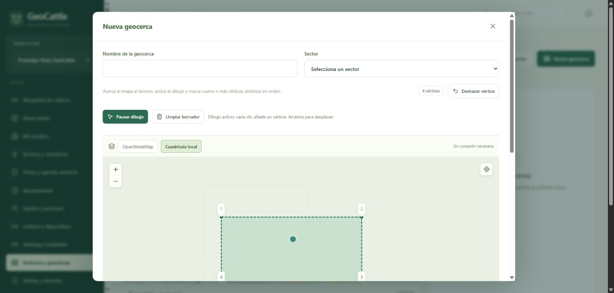

# Revisión de mapas, asociaciones y perfiles de GeoCattle

Fecha: 23 de octubre de 2026. Entorno operativo: prototipo local, PostgreSQL/PostGIS y receptora T3 en COM5. Referencia funcional: los diagramas UML V3 aportados por el usuario y el catálogo conservado en `docs/especificacion-v3/`.

## Resultado y alcance

Se corrigió la visualización de OpenStreetMap y el editor de geocercas; se hizo explícita y trazable la relación collar–animal–sector–geocerca; y se revisaron los permisos y las vistas de dueño, trabajador, veterinario y administrador. La API actualizada está desplegada en http://localhost:8084. La captura física continúa funcionando.

Se conservaron los archivos originales de GitHub, las lecturas, sus asociaciones históricas, las versiones de geocerca y la evidencia anterior. Esta revisión no cambia el firmware ni las conexiones de las placas. No certifica una prueba de campo con 70 collares ni la ejecución completa de los 29 casos del catálogo.

## Mapas y creación de geocercas

| Problema encontrado | Corrección aplicada | Comprobación |
|---|---|---|
| Mapa incompleto al abrir el modal | Se observa el tamaño real del contenedor y se llama a `invalidateSize` al cambiar | Editor de 985 × 420 px con las 12 teselas visibles cargadas |
| Un error de una tesela podía ocultar toda la cartografía | Se conserva la capa, se indica carga parcial y se ofrece reintentar | Alternancia de base y conservación del borrador comprobadas |
| Las actualizaciones de posiciones podían cambiar el encuadre mientras se trabajaba | Ajuste inicial al recibir datos; posteriores ajustes solo por acción explícita | Cuatro vértices conservados, sin desplazamiento del mapa durante el dibujo |
| Controles del mapa podían agregar puntos accidentales | Se ignoran clics en controles y ventanas del mapa | Zoom sin añadir vértices |
| No estaba claro cómo dibujar o trabajar sin Internet | Controles OpenStreetMap/Cuadrícula local y activar/pausar dibujo | Se cambió de base sin perder los cuatro vértices |
| Cambiar el nombre podía enviar una versión inicial incorrecta | La versión vigente se localiza por sector | Se conserva el esquema de una geocerca activa por sector y sus versiones |
| Importaciones con huecos eran incompatibles con el backend | Rechazo temprano con explicación | Se admite el contorno exterior previsto por el contrato |
| Historial unido sin orden ni continuidad suficiente | Orden cronológico y separación por sesión, collar, falta de fix o intervalo largo | Se evitan trazos que aparenten un recorrido continuo inexistente |

El editor dispone de centrar coordenadas, añadir vértice, deshacer, borrar borrador y activar/pausar dibujo. Usa como contexto las últimas posiciones válidas de los collares del predio, incluso si todavía no están asignados. Una posición histórica se identifica como tal; no representa una ubicación actual.

La cuadrícula permite trabajar sin cartografía externa, pero no contiene caminos ni imágenes del terreno. OpenStreetMap requiere conexión. Se usa el endpoint oficial de teselas con atribución y política de referencia; no se añadió descarga masiva. Referencias: [política oficial de teselas OpenStreetMap](https://operations.osmfoundation.org/policies/tiles/) y [documentación de Leaflet sobre tamaño del mapa](https://leafletjs.com/reference.html#map-invalidatesize).

### Uso recomendado

1. Abrir **Sectores y geocercas** y seleccionar o crear un sector activo.
2. Abrir **Nueva geocerca**; centrar el mapa en el terreno mediante las posiciones disponibles o coordenadas conocidas.
3. Activar el dibujo y marcar al menos tres vértices del contorno. Pausar para explorar sin añadir puntos.
4. Revisar el contorno y guardar. El servidor valida la geometría y controla la versión.
5. Abrir la ficha del bovino y asignar la zona de pastoreo. Esto vincula la geocerca exacta y actualiza su sector, conservando la vigencia anterior.

La prueba visual del editor utilizó un borrador que se canceló; no se guardó una geocerca de prueba en el predio operativo.

## Asociaciones de collar, animal y pastoreo

La ficha del animal muestra ahora el collar vinculado y la geocerca exacta de pastoreo, con su sector, versión y fecha de inicio. Incluye un historial paginado de ambas asociaciones, sus vigencias y responsables. El listado y el dashboard conservan su consulta habitual; los detalles adicionales se consultan al abrir la ficha.

Se corrigieron estas inconsistencias:

- Al reasignar un collar se limpian los estados de todos los animales afectados, incluido el que pierde el collar. Se cierran los eventos del contexto anterior con motivo explícito y auditoría, conservando su evidencia y estado de atención. Un cierre por reasignación **no significa que el sensor haya confirmado una recuperación**.
- El sector no puede editarse de forma que contradiga la zona de pastoreo vigente. Debe cambiarse mediante la asignación de zona, que conserva el intervalo anterior.
- Se rechazan nuevas asignaciones a sectores inactivos y pastoreo a animales deshabilitados. Cada nueva versión de geocerca registra su autor.
- Un cierre retroactivo que dejaría lecturas persistidas fuera de su asignación original se rechaza. No se reatribuyen lecturas históricas a otro animal ni se convierten datos previos sin asignación en datos de un bovino.

Las asociaciones conservan intervalos temporales sin solapamiento: un collar activo por animal, un animal activo por collar y una zona de pastoreo activa por animal. Las versiones anteriores de geocerca se conservan. Los recursos se consultan dentro del predio autorizado; trabajador y veterinario pueden leer asociaciones, pero su modificación corresponde al dueño o al administrador en contexto de soporte.

**Verificación efectiva:** el registro `associations-tests.txt` confirma **11 casos aprobados**; `backend-tests.txt` confirma **80 pruebas aprobadas en total**, incluidas esas 11. Cubren reasignación con dos animales/collares, evidencia histórica, corte retroactivo, coherencia de sector, sectores inactivos, animal deshabilitado, autoría, aislamiento entre predios, permisos de trabajador/veterinario y paginación tras versionar una geocerca. Aparece una advertencia de deprecación de la infraestructura `Starlette TestClient/httpx`; no es un fallo de la aplicación. Las pruebas usan una base QA aislada y transacciones de reversión; no modifican las lecturas reales del prototipo.

**Límites de esta entrega:** todavía no existe una acción independiente para desasignar un collar sin reemplazarlo; deshabilitar el dispositivo no equivale a cerrar su instalación histórica. Tampoco se implementó el traslado de un animal entre predios: las permanencias y sus restricciones existen en el modelo, pero falta ese flujo de operación. La comprobación de las asociaciones y lecturas reales del prototipo se informa por separado y no debe confundirse con las pruebas QA.

## Comprobación con datos físicos

Se comprobó de solo lectura la asociación vigente entre el collar físico, el animal, el sector y la geocerca del prototipo. Las lecturas nuevas correspondían al animal según la vigencia, y las anteriores sin asignación se conservaron sin atribución retrospectiva. No se creó otra instalación ni se reescribió telemetría.

La ausencia de fix en un paquete no demuestra un fallo de OpenStreetMap ni una salida del animal: se conserva la posición anterior con su antigüedad. La recepción radio y la fijación satelital son comprobaciones distintas. El detalle de identificadores, lecturas y horas se conserva solo en el registro privado `.runtime/review/live-verification.json`.

## Perfiles, permisos y correspondencia con los diagramas UML

Revisión de código realizada el 23 de octubre de 2026. Los cambios indicados abajo ya están aplicados en el proyecto; se conservaron los datos y el funcionamiento de la captura de collares.

| Perfil o contexto | Cobertura efectiva frente al UML aportado |
|---|---|
| Administrador de plataforma | Acceso con MFA, gestión de clientes y colaboradores incorporados, KPI, auditoría y perfil propio. La selección de un predio abre el contexto de soporte con identidad administrativa propia. |
| Dueño | Gestión de sus predios, equipo, sectores, geocercas y asignaciones; mapa, fichas y sensores; decisiones sobre solicitudes y confianza específica; reglas y dispositivos. |
| Trabajador | Mapa, fichas, sensores y atención de alertas del predio autorizado. Los reportes de estado, batería y administración sanitaria generan propuestas por defecto; una confianza vigente habilita solamente la acción concedida. No gestiona predios, DIIO, asignaciones ni colaboradores. |
| Veterinario | Consulta del predio y cambios directos de ficha técnica, sanitaria y agenda, con autoría e historial. No recibe facultades de dueño para asignar collares, gestionar equipo o modificar el estado vital mediante el flujo operativo. |
| Soporte administrativo | Opera desde el predio seleccionado, conserva su identidad y deja auditoría. La gestión de equipo y confianza exige autorización MFA vinculada a la operación exacta. |
| Perfil heredado de consulta | Se mantiene como lectura; no se convierte en ninguno de los cuatro perfiles del diseño ni obtiene permisos de escritura. |

El servidor recalcula el contexto autorizado en cada solicitud y aplica el alcance por predio. En la interfaz, el cambio de predio desmonta la vista y reinicia sus formularios y modales mediante una clave de usuario, predio y rol. La navegación muestra las acciones correspondientes al perfil; esta presentación complementa las comprobaciones del servidor.

**Ajustes aplicados.** Se corrigieron los botones sanitarios que antes ofrecían al trabajador corregir o anular reportes ajenos, aunque el servidor rechazaba esas operaciones. Ahora se comprueba la identidad `recorded_by` y solo se muestran para sus propios reportes permitidos. También se corrigió el panel de administrador en Windows: la ausencia de una medición de carga del sistema devuelve `null` y se presenta como «Sin medición», sin impedir consultar los demás KPI.

**Verificación.** La validación automatizada registrada comprende 80 pruebas de backend y 26 de contratos/adaptadores correctas. Incluye aislamiento entre predios, restricciones por perfil, propuesta frente a aplicación directa, confianza revocable, autoría sanitaria y retirada de acceso de una sesión con membresía revocada. Esta comprobación de código no se presenta como prueba visual completa de todos los casos de uso; la revisión visual en la base QA aislada se registra por separado.

**Límites del prototipo.** Las invitaciones se entregan manualmente: no está configurado el correo externo. El panel de recepción USB está reservado al dueño y soporte; trabajadores y veterinarios consultan sensores desde la ficha del animal. El estado del receptor describe el único puente USB local y sus contadores de captura; un despliegue con puentes para varios predios requerirá asociar cada receptor a su predio. El contraste cubre los grupos funcionales presentes en los diagramas y no certifica, por sí solo, la ejecución completa de los 29 casos del catálogo.

Referencias de implementación: `frontend/src/App.tsx:93`, `frontend/src/App.tsx:129`, `frontend/src/V3Health.tsx:32`, `frontend/src/V3Admin.tsx:60`, `backend/geocattle/v3_security.py:58`, `backend/geocattle/v3_operation_auth.py:111`, `backend/geocattle/v3_api.py:467` y `backend/geocattle/v3_api.py:508`.

### Revisión visual efectiva de perfiles

Se inició una API temporal en `127.0.0.1:8085` conectada exclusivamente a `geocattle_review_20261023`. Las cuatro cuentas, el predio «QA aislada revisión» y su bovino son ficticios. No se inició worker ni captura USB para esta instancia. Las sesiones de QA se cerraron al terminar y sus credenciales no se incluyen en el informe ni en Git.

| Vista abierta en navegador | Resultado comprobado |
|---|---|
| Dueño | Panel del predio, recepción, bovinos, equipo, collares, geocercas y aprobaciones disponibles |
| Trabajador | Panel, bovinos, fichas, reportes y alertas; no se ofrecen administración de predios, equipo o asignaciones. Formulario de reporte abierto y cancelado |
| Veterinario | Panel y ficha sanitaria; edición técnica, registro de evento y planificación disponibles. Sin administración de collares/equipo |
| Administrador global | Se exigió y verificó TOTP. KPI carga en Windows; métricas no disponibles muestran «Sin medición» |
| Administrador en soporte | Selección del predio QA abre su panel manteniendo identidad administrativa y contexto de soporte |

Esta revisión verifica acceso, navegación, controles y carga de las pantallas indicadas. Las escrituras y denegaciones de permisos se comprobaron con pruebas automatizadas aisladas; no se realizaron tratamientos ni cambios operativos ficticios en el predio real.

Evidencia: [dueño](evidencias/revision-2026-10-23/GeoCattle-perfil-dueno-QA.png), [trabajador](evidencias/revision-2026-10-23/GeoCattle-perfil-trabajador-QA.png), [veterinario](evidencias/revision-2026-10-23/GeoCattle-perfil-veterinario-QA.png), [administrador global](evidencias/revision-2026-10-23/GeoCattle-perfil-administrador-QA.png) y [soporte](evidencias/revision-2026-10-23/GeoCattle-perfil-soporte-QA.png).

## Verificación técnica y preservación

| Verificación | Resultado y alcance |
|---|---|
| Backend | 80 pruebas correctas, incluidas las 11 de asociaciones, restricciones por perfil y KPI Windows |
| Contratos y adaptadores de telemetría | 26 pruebas correctas |
| TypeScript y compilación Vite | Correctas; queda aviso de tamaño del paquete principal de aproximadamente 504 kB sin comprimir |
| Cambios de formato | `git diff --check` sin errores |
| API operativa | `/api/v1/health` responde correctamente; ruta de historial de asociaciones desplegada |
| Captura COM5 | Activa y sin mensajes pendientes en las comprobaciones de esta revisión |
| Datos | Base operativa y capturas conservadas. QA usa otra base y pruebas con reversión transaccional |

Los registros automatizados de backend y asociaciones se conservan en `.runtime/review/backend-tests.txt` y `.runtime/review/associations-tests.txt`. El registro inicial de roles que contenía el fallo de carga de sistema en Windows se conserva como evidencia previa; quedó superado por el resultado final de 80 pruebas correctas tras corregir ese fallo. La advertencia de deprecación de TestClient no impidió ejecutar las pruebas.

Los detalles de asociaciones se consultan al abrir la ficha; no se añadieron esas consultas adicionales por animal al dashboard. El historial se pagina en servidor, con un máximo de 200 asociaciones por petición. La cartografía ya no se reencuadra en cada nueva lectura. Estas medidas reducen trabajo innecesario sin afirmar capacidad de campo todavía no medida.

## Límites y siguientes mejoras priorizadas

| Prioridad | Mejora pendiente | Motivo |
|---|---|---|
| Alta | Prueba física con GPS vigente: interior, dos posiciones exteriores y regreso | Cerrar la validación de geocerca con el collar real; el último corte no tenía fix vigente |
| Alta | Acción de retirar/desasignar collar sin reemplazo | Deshabilitar un dispositivo no cierra por sí solo su instalación histórica |
| Media | Búsqueda/paginación de animales en el selector de asignación de collar | Actualmente toma los primeros 100; alcanza el objetivo inicial de 70, pero debe ampliarse para rebaños mayores |
| Media | Flujo explícito de traslado entre predios | El modelo conserva permanencias; falta completar su operación en interfaz |
| Media | Relacionar cada puente receptor con su predio | El despliegue actual solo tiene un puente USB local |
| Media | Validar comunicación de configuración y confirmación física | El firmware LoRa punto a punto actual no confirma cambios remotos; una solicitud pendiente no prueba aplicación |
| Media | Medir ingestión, consultas, retención y recuperación con 70 collares | Las pruebas de software y un collar no equivalen a una prueba de carga de campo |
| Baja | Dividir más el paquete principal de la interfaz | Atender el aviso de tamaño de Vite después de medir carga inicial |

Las notificaciones externas e invitaciones por correo requieren configuración y pruebas propias; se mantiene el flujo manual existente. La clasificación reposo/movimiento y los umbrales preventivos necesitan validación con animales reales y no se interpretan como diagnóstico sanitario. El análisis de almacenamiento diario e histórico se conserva en [el informe de telemetría](INFORME_ALMACENAMIENTO_TELEMETRIA.md).

## Archivos principales de esta revisión

- Mapas, dibujo y formularios: `frontend/src/Map.tsx`, `PagesManagement.tsx`, `PagesAnimals.tsx`, `types.ts`, `styles.css`.
- Perfiles y KPI: `frontend/src/App.tsx`, `V3Health.tsx`, `V3Admin.tsx`, `v3types.ts`; `backend/geocattle/v3_api.py`.
- Asociaciones e historial: `backend/geocattle/main.py`, `domain.py`.
- Regresiones: `backend/tests/test_v3_legacy_assignments.py`, `test_v3_api.py`, `test_v3_platform_metrics.py`.
- Contrato: [CONTRATO_API.md](CONTRATO_API.md).

Los cambios de integración USB y visualización de sensores de sesiones anteriores se mantienen; no se eliminaron ni se presentan aquí como desarrollo nuevo.
