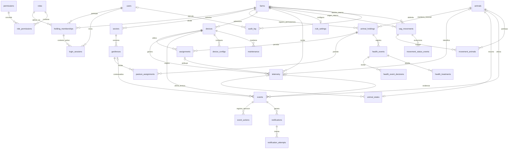

# GeoCattle — Modelo lógico propuesto V2

Estado: propuesta de diseño, no implementada. Fecha: 20 de octubre de 2026.

Este modelo amplía las migraciones actuales de GeoCattle. Conserva alertas, notificaciones, configuración IoT, mantenimiento y sesiones; incorpora membresías y roles por predio, ficha sanitaria inmutable y movimientos FMA. Los nombres plurales conservan la convención del proyecto. `farms` equivale a `holding`; `assignments` a `animal_device_assignment`; `pasture_assignments` a `animal_geofence_assignment`.

No se modifica el modelo documentado como implementado ni se ejecutan migraciones. Este documento define entidades, atributos, claves, cardinalidades y reglas de negocio; los índices, triggers y mecanismos de concurrencia se concretarán en el diseño físico.

## 1. Convenciones y decisiones

- PK: clave primaria. FK: clave foránea. UQ: unicidad. NN: obligatorio. `?`: atributo opcional. Salvo indicación contraria, los atributos listados son obligatorios.
- Identificadores internos UUID; fechas operativas con zona horaria (`timestamptz`); fechas civiles `date`; magnitudes con unidad explícita. Tiempos almacenados de manera consistente y presentados con zona del predio.
- Cada usuario tiene una identidad global y puede participar en varios predios. Cada membresía tiene un rol vigente. Para cambiar de rol se cierra el intervalo y se crea una nueva membresía.
- Un animal tiene como máximo una permanencia predial activa, un collar activo y una asignación de pastoreo activa. Se admiten períodos sin asignación. Una geocerca puede tener muchos animales.
- Dispositivos, sectores y geocercas pertenecen a un predio. El traslado de un collar entre predios requiere cerrar asignaciones y un procedimiento explícito; no se modifica silenciosamente su predio.
- La telemetría conserva la atribución histórica al animal y a su asignación, incluso si el collar se reasigna después.
- La ficha sanitaria y sus decisiones son append-only. Una corrección o anulación es un nuevo registro, no una edición del registro original.
- PostgreSQL/PostGIS es la base propuesta. TimescaleDB queda como decisión física posterior; no se declara una hypertable ni una mejora de rendimiento sin validar carga y compatibilidad.

## 2. Diagrama general

Las líneas representan FK y participación estructural. Las reglas temporales, de aprobación y de transición se detallan después; no quedan expresadas únicamente por las cardinalidades. El diagrama omite FK secundarias de autoría y algunas FK de predio para mantener legibilidad.

## 3. Diccionario lógico

### A. Identidad, permisos y predios

| Entidad | Atributos y claves | Reglas principales |
|---|---|---|
| `users` | `id` PK; `username` UQ; `password_hash`; `full_name`; `email?`; `rut?` UQ cuando existe; `active`; `created_at` | Identidad global. El RUT es opcional y normalizado; no usarlo como PK. No repetir cuentas por predio. |
| `farms` | `id` PK; `rup?` UQ cuando existe; `name`; `owner_name?`; `owner_rut?`; `region?`; `commune?`; `address?`; `timezone`; `boundary?` multipolígono WGS84; `environment`; `active`; `created_at`; `updated_at` | RUP obligatorio antes de confirmar una operación oficial que lo requiera; opcional para simulación o incorporación inicial. Los datos del titular no conceden permisos de acceso. |
| `roles` | `id` PK; `code` UQ; `name`; `description`; `active` | Catálogo: `owner`, `operator`, `veterinarian`, `viewer`. Son perfiles del producto. |
| `permissions` | `id` PK; `code` UQ; `description` | Permisos concretos, por ejemplo `health.create` y `movement.confirm`. |
| `role_permissions` | `role_id` PK/FK → roles; `permission_id` PK/FK → permissions | PK compuesta. Define permisos del rol; cambios auditados. |
| `holding_memberships` | `id` PK; `farm_id` FK → farms; `user_id` FK → users; `role_id` FK → roles; `valid_from`; `valid_to?`; `granted_by?` FK → users | Sin intervalos superpuestos para el mismo usuario y predio. `valid_to > valid_from`. La desactivación global del usuario revoca acceso a todas sus membresías. |
| `login_sessions` | `token_hash` PK; `user_id` FK → users; `active_membership_id` FK → holding_memberships; `csrf_token`; `created_at`; `expires_at`; `revoked_at?` | La membresía debe pertenecer al usuario y estar vigente en cada operación. Cambiar contexto de predio exige validar la nueva membresía. |
| `audit_log` | `id` PK; `farm_id` FK → farms; `actor_id?` FK → users; `membership_id?` FK → holding_memberships; `actor_type`; `action`; `entity_type`; `entity_id?`; `before?` JSON; `after?` JSON; `ip_address?`; `request_id?`; `occurred_at` | Inmutable. `actor_type`: usuario/sistema/servicio. Un actor automático puede no tener usuario. `entity_id` es referencia polimórfica, no FK universal. Excluir contraseñas, tokens y secretos de snapshots. |

Los sucesos globales sin predio, como un inicio de sesión fallido antes de seleccionar contexto, se registran en logs de seguridad separados; `audit_log` es auditoría predial. La membresía de auditoría identifica el contexto histórico y no exige seguir vigente al consultar el registro.

### B. Ganado y espacio

| Entidad | Atributos y claves | Reglas principales |
|---|---|---|
| `animals` | `id` PK; `diio` UQ; `name?`; `species`; `sex`; `breed_code?`; `breed_name?`; `production_type`; `birth_date?`; `birth_date_estimated`; `category?`; `reproductive_status?`; `status`; `row_version`; `created_at` | DIIO como texto para conservar ceros. Estado vital separado de ubicación: cambiar de predio no significa dar de baja al animal. Los datos desconocidos no se reemplazan por fechas ficticias. |
| `animal_holdings` | `id` PK; `animal_id` FK → animals; `farm_id` FK → farms; `valid_from`; `valid_to?`; `entry_movement_id?` FK → sag_movements; `exit_movement_id?` FK → sag_movements; `reason`; `recorded_by?` FK → users | Historial de permanencia, independiente del collar. Sin solapamientos por animal; intervalos `[inicio, fin)`. Conserva registros del predio anterior. |
| `sectors` | `id` PK; `farm_id` FK → farms; `name`; `active` | UQ `(farm_id, name)`. Representa un potrero o sector estable. |
| `geofences` | `id` PK; `farm_id` FK → farms; `sector_id` FK → sectors; `name`; `version`; `geometry` polígono WGS84; `valid_from`; `valid_to?`; `created_by` FK → users | UQ `(sector_id, version)`; sin vigencias superpuestas por sector. Geometría válida, no vacía y de área positiva. Cambiar el polígono crea una versión. |
| `pasture_assignments` | `id` PK; `farm_id` FK → farms; `animal_holding_id` FK → animal_holdings; `geofence_id` FK → geofences; `valid_from`; `valid_to?`; `assigned_by` FK → users; `reason?` | Sin superposición por animal, incluso entre permanencias. Animal y geocerca del mismo predio; intervalo contenido en permanencia y versión de geocerca. |

`animal_holdings` sustituye el vínculo mutable `animals.farm_id`: un cambio de establecimiento conserva la historia. El predio actual se obtiene de la permanencia vigente. No existe un segundo campo editable de predio actual. La visibilidad del historial entre predios se decide por autorización; haber tenido un animal no concede acceso automático a sus registros futuros.

No se incluye un calendario como texto ni prioridad de pastoreo: el intervalo representa la planificación temporal y se adopta una única geocerca por animal en cada instante. Un calendario recurrente requeriría otra entidad si se solicita posteriormente.

### C. Infraestructura IoT y telemetría

| Entidad | Atributos y claves | Reglas principales |
|---|---|---|
| `devices` | `id` PK; `farm_id` FK → farms; `hardware_id` UQ; `serial_number?` UQ; `dev_eui?` UQ; `name`; `transport`; `hardware_revision?`; `firmware_version?`; `battery_capacity_mah?`; `status`; `interval_seconds`; `config_version`; `installed_at?`; `last_observed_at?`; `last_received_at?`; `last_telemetry_id?` FK → telemetry | `dev_eui` normalizado de 16 dígitos hexadecimales cuando existe. Se conserva transporte académico/LoRaWAN. Estado de inventario no equivale a conectividad. |
| `assignments` | `id` PK; `farm_id` FK → farms; `animal_holding_id` FK → animal_holdings; `device_id` FK → devices; `valid_from`; `valid_to?`; `assigned_by` FK → users; `reason?` | Sin superposición por animal ni dispositivo. Contenido en la permanencia del animal y con coincidencia de predio. Cerrar una asignación conserva sus lecturas. |
| `telemetry` | `id` PK; `farm_id` FK → farms; `device_id` FK → devices; `assignment_id?` FK → assignments; `animal_id?` FK → animals; `session_id`; `seq`; `observed_at`; `received_at`; `longitude?`; `latitude?`; `point?` WGS84; `gnss_valid`; `surface_temperature_c?`; `activity_index?`; `pulse_bpm?`; `battery_mv?`; `rssi_dbm?`; `snr_db?`; `source`; `quality` JSON; `config_version?` | UQ `(device_id, session_id, seq)`. Inmutable. Asignación y animal ambos presentes o ambos ausentes. Atribución válida en `observed_at`. Ausencia de sensor = NULL, no cero. |
| `device_configs` | `id` PK; `device_id` FK → devices; `version`; `interval_seconds`; `status`; `requested_by` FK → users; `requested_at`; `sent_at?`; `applied_at?`; `error?` | UQ `(device_id, version)`; como máximo una configuración pendiente por collar. Diferenciar solicitada, enviada y confirmada. |
| `maintenance` | `id` PK; `farm_id` FK → farms; `device_id` FK → devices; `battery_id?`; `kind`; `occurred_at`; `responsible_id` FK → users; `result` | Registro inmutable de inspección, recarga, reemplazo o retiro. Correcciones mediante una nueva anotación auditada. |

Se almacenan coordenadas y punto por compatibilidad con el proyecto, pero el punto debe derivarse de las coordenadas o comprobarse su equivalencia. Con GNSS inválido, ambos quedan NULL. Latitud entre −90 y 90; longitud entre −180 y 180; batería no negativa. Las unidades y rangos dependen del dispositivo validado.

`animal_id` en telemetría es una redundancia intencional para consultas históricas: debe coincidir con el animal de la asignación. La ingestión valida también dispositivo, predio e intervalo. Una lectura sin asignación puede almacenarse para diagnóstico, sin inventar su animal. Una lectura no puede atribuirse usando únicamente la asignación vigente al momento de recepción.

`session_id` identifica una sesión de captura persistente y no se inventa de nuevo por cada reintento de transporte. `pulse_bpm` solo se llena si existe una medición respaldada por el hardware.

### D. Estado, alertas y notificaciones

| Entidad | Atributos y claves | Reglas principales |
|---|---|---|
| `animal_states` | `animal_id` PK/FK → animals; `telemetry_id?` FK → telemetry; `position_telemetry_id?` FK → telemetry; `observed_at?`; `outside_count`; `geofence_status`; `updated_at` | Proyección reconstruible. Las lecturas deben corresponder al animal. Se recalcula al cambiar su contexto predial. |
| `rule_settings` | `farm_id` PK/FK → farms; `version`; `battery_low_mv`; `temperature_high_c?`; `activity_low_threshold?`; `activity_window_minutes`; `proximity_meters`; `temperature_enabled`; `activity_enabled`; `proximity_enabled`; `updated_at`; `updated_by` FK → users | Una configuración vigente por predio; cambios auditados. No activar una regla sin parámetros válidos. |
| `events` | `id` PK; `farm_id` FK → farms; `animal_id?` FK → animals; `device_id` FK → devices; `telemetry_id?` FK → telemetry; `geofence_id?` FK → geofences; `type`; `severity`; `condition`; `attention`; `opened_at`; `resolved_at?`; `detail` JSON | Como máximo una alerta técnica activa por dispositivo y tipo. Separar condición técnica de atención humana. |
| `event_actions` | `id` PK; `event_id` FK → events; `actor_id` FK → users; `membership_id` FK → holding_memberships; `action`; `occurred_at`; `note` | Inmutable; actor autorizado en el predio al realizar la acción. |
| `notifications` | `id` PK; `event_id` FK → events; `recipient_user_id?` FK → users; `recipient_address`; `channel`; `status`; `created_at`; `requested_at?`; `next_attempt_at` | Destinatario/dirección conservados como evidencia del envío. El acceso al destino y su retención deben restringirse. |
| `notification_attempts` | `id` PK; `notification_id` FK → notifications; `attempt`; `occurred_at`; `status`; `provider_id?`; `error?` | UQ `(notification_id, attempt)`; inmutable. Aceptación del proveedor no significa lectura por el destinatario. |

Se conservan los tipos de alerta actuales: escape, ausencia de comunicación, batería baja, temperatura superficial alta, baja actividad, proximidad y fallo de configuración. Una alerta de temperatura no es un diagnóstico clínico ni crea automáticamente un diagnóstico aprobado.

### E. Ficha sanitaria append-only

| Entidad | Atributos y claves | Reglas principales |
|---|---|---|
| `health_events` | `id` PK; `farm_id` FK → farms; `animal_holding_id` FK → animal_holdings; `event_type`; `operation`; `target_event_id?` FK → health_events; `occurred_at`; `recorded_at`; `created_by` FK → users; `membership_id` FK → holding_memberships; `clinical_signs?`; `diagnosis?`; `surface_temperature_c?`; `weight_kg?`; `notes?` | Inmutable. `operation`: registro/corrección/anulación. `event_type`: examen, signo, diagnóstico, vacuna, tratamiento, procedimiento, lesión o muerte. |
| `health_treatments` | `id` PK; `health_event_id` FK → health_events; `product_name`; `sag_registration?`; `batch_number?`; `dose_value`; `dose_unit`; `route`; `administered_at`; `withdrawal_meat_until?` date; `withdrawal_milk_until?` date; `withdrawal_basis?` | Cero o varios productos por evento. Inmutable. Dosis positiva y unidad obligatoria; resguardo con fuente o indicación documentada. |
| `health_event_decisions` | `id` PK; `health_event_id` FK → health_events; `decision`; `decided_by` FK → users; `membership_id` FK → holding_memberships; `decided_at`; `reason?` | Inmutable. Una decisión terminal por evento: aprobar o rechazar. Rechazo con motivo obligatorio. Pendiente = ausencia de decisión. |

Reglas del flujo:

1. El autor registra el evento y sus tratamientos en una misma transacción. El contenido queda inmutable inmediatamente.
2. La membresía del autor debe autorizar registro sanitario en el predio. `occurred_at` debe corresponder a la permanencia referenciada; se permite registro posterior con autorización.
3. Un propietario autorizado aprueba o rechaza. La aprobación es validación del registro dentro del producto, no certificación de exactitud clínica.
4. Una corrección aprobada sustituye lógicamente al evento referenciado; una anulación aprobada lo deja sin efecto. El original permanece visible con su cadena de decisiones.
5. La referencia debe pertenecer al mismo animal y contexto predial. Solo se puede sustituir la versión efectiva; la validación se serializa para impedir dos sucesores aprobados del mismo evento. No se permiten ciclos.
6. Un evento rechazado no se edita: se presenta uno nuevo. Una decisión errónea se resuelve con un nuevo evento correctivo autorizado, preservando la decisión original.
7. Un tratamiento registrado pendiente se muestra como advertencia provisional de resguardo; el rechazo no demuestra que el fármaco no fue administrado. La vista operativa conserva esa advertencia hasta una resolución explícita documentada. Este flujo es una decisión funcional propuesta y debe validarse con el responsable sanitario.

No existen `voided_at` ni un `approved_by` editable en `health_events`; se derivan del historial. Un usuario no puede borrar un tratamiento para eludir un período de resguardo.

### F. Movimientos y formularios FMA

| Entidad | Atributos y claves | Reglas principales |
|---|---|---|
| `sag_movements` | `id` PK; `managing_farm_id` FK → farms; `fma_folio?` UQ cuando existe; `origin_farm_id?` FK → farms; `destination_farm_id?` FK → farms; `origin_rup`; `destination_rup`; `planned_departure_at?`; `departure_at?`; `arrival_at?`; `carrier_name?`; `carrier_rut?`; `vehicle_plate?`; `species`; `created_by` FK → users; `created_at`; `document_reference?` | RUP de origen/destino son snapshots. Las FK de establecimientos externos pueden ser NULL. No crear predios operativos ficticios para cada destino externo. |
| `movement_animals` | `movement_id` PK/FK → sag_movements; `animal_id` PK/FK → animals; `diio_snapshot` | PK compuesta evita animales duplicados. DIIO declarado preservado al confirmar. |
| `movement_status_events` | `id` PK; `movement_id` FK → sag_movements; `status`; `occurred_at`; `recorded_at`; `actor_id?` FK → users; `source`; `external_reference?`; `reason?` | Inmutable. Estados: borrador, confirmado_localmente, presentado, confirmado_externamente, ejecutado, cancelado. El último evento según orden de registro/transacción determina estado vigente; los eventos se serializan por movimiento. |

Reglas del flujo:

1. `managing_farm_id` fija quién administra el registro; no concede automáticamente acceso a otro predio interno. Origen/destino internos deben coincidir con sus RUP registrados.
2. Un borrador puede contener cero animales y no tener folio. Confirmar exige al menos un animal, RUP distintos y datos requeridos por el proceso validado con SAG. Si se representa un FMA oficial, exige además folio y respaldo verificable.
3. Los animales deben corresponder al establecimiento de origen en la salida. Se bloquean movimientos incompatibles simultáneos. La selección de animales no cambia por sí misma su ubicación.
4. Tras confirmar, cabecera y detalle se congelan. Cambios requieren cancelación y nuevo documento cuando corresponda; no se reescribe evidencia oficial.
5. Solo una ejecución verificada actualiza permanencias: cierra la anterior y abre la de destino si este se administra en GeoCattle. Un destino externo puede dejar al animal sin permanencia interna activa.
6. El cierre de permanencia cierra asignaciones de collar y pastoreo en la misma transacción. El collar no se traslada automáticamente con el animal. Las reglas de muerte/baja también deben cerrar asignaciones incompatibles.
7. Registrar llegada a un destino interno puede abrir permanencia al arribo, dejando un intervalo de tránsito sin permanencia interna. El documento conserva salida y llegada; no es necesario inventar un predio de tránsito.
8. Una cancelación posterior a ejecución no revierte silenciosamente permanencias: requiere regularización explícita y auditada. Las transiciones se validan contra el estado previo.
9. GeoCattle registra y prepara información; no se presume integración con SIPECweb. `confirmado_externamente` exige evidencia de confirmación, no una simple acción local.

## 4. Matriz inicial de permisos

Es una política inicial del producto; se implementa mediante `permissions` y `role_permissions`, no por el nombre visible del rol.

| Acción | Propietario | Trabajador | Veterinario | Consulta |
|---|---|---|---|---|
| Consultar monitoreo del predio | Sí | Sí | Sí | Sí |
| Administrar membresías y roles del predio | Sí | No | No | No |
| Asignar collares y pastoreo | Sí | Sí | No | No |
| Solicitar configuración / registrar mantenimiento | Sí | Sí | No | No |
| Atender alertas | Sí | Sí | Sí | No |
| Registrar observaciones sanitarias | Sí | Sí | Sí | No |
| Registrar diagnóstico o tratamiento clínico | No, salvo autorización clínica adicional | No | Sí | No |
| Aprobar o rechazar ficha sanitaria | Sí | No | No | No |
| Preparar borrador FMA | Sí | Sí | No | No |
| Confirmar movimiento / registrar ejecución verificada | Sí | No | No | No |
| Consultar auditoría | Sí | No | No | No |

Si una persona necesita combinar rol propietario y capacidad clínica, se debe ampliar explícitamente la política (por ejemplo, múltiples roles por membresía). Esta versión adopta un único rol por membresía para mantener el alcance definido. No se utiliza el poder de administración como sustituto de atribuciones clínicas.

## 5. Restricciones transversales

- Todas las referencias deben existir; cada FK opcional debe tener una causa funcional documentada.
- Usar claves compuestas con `farm_id` donde corresponda y verificaciones transaccionales para impedir cruces de predio. Una FK simple de UUID no basta para demostrar pertenencia.
- El usuario autor debe tener membresía y permiso válidos al ejecutar la acción. Una membresía histórica no autoriza operaciones nuevas.
- Intervalos con fin posterior al inicio, semántica `[inicio, fin)` y exclusión de superposiciones bajo concurrencia. NULL en el fin representa vigencia abierta.
- No eliminar en cascada animales, usuarios, predios ni documentos con historia. Desactivar entidades y conservar referencias. La política de retención de datos personales se define separadamente.
- La inmutabilidad requiere permisos de base y mecanismos físicos; la etiqueta append-only en un diagrama no la garantiza. Cerrar intervalos y actualizar proyecciones sí son mutaciones permitidas y auditadas.
- Auditoría, acciones de alertas, telemetría, mantenimiento, intentos, eventos sanitarios, tratamientos, decisiones y estados de movimiento son registros inmutables. Cabecera/detalle FMA solo son editables en borrador.
- `before`/`after` no incluyen secretos ni copias indiscriminadas de datos personales. Acceso, retención, respaldo y recuperación se diseñan aparte; este esquema no acredita cumplimiento normativo.
- `row_version` y bloqueos/transacciones controlan modificaciones concurrentes. Las reglas de aprobación, traslado y asignación no dependen solo de validación de interfaz.
- `animal_states`, últimos tiempos del dispositivo y estado actual de un movimiento son proyecciones; la historia conserva la autoridad para reconstruirlos.

## 6. TimescaleDB: condición de una migración futura

La PK lógica de telemetría es `id` y la clave de deduplicación es `(device_id, session_id, seq)`. No se deben trasladar ambas sin cambios a una hypertable particionada por tiempo: Timescale exige que cada restricción única incluya las columnas de particionamiento.

Antes de adoptar Timescale se debe definir una estrategia física para mantener deduplicación global y referencias desde alertas/proyecciones: por ejemplo, un registro ordinario de identidad/deduplicación y un almacenamiento temporal separado, o una revisión integral de claves compuestas. Agregar `observed_at` a la unicidad sin más debilita la deduplicación si una retransmisión cambia su marca temporal. Esta propuesta conserva PostgreSQL ordinario hasta resolver y probar esa migración.

## 7. Correspondencia y orden de implementación

| Base actual | Propuesta V2 | Acción prevista |
|---|---|---|
| `farms` | `farms` enriquecida | Agregar RUP, titular y atributos territoriales opcionales. |
| `users.farm_id`, `users.role` | `holding_memberships`, `roles`, `permissions`, `role_permissions` | Migrar cada relación actual a una membresía; conservar identidades y hashes. |
| `animals.farm_id`, `animals.sector_id` | `animal_holdings`, `pasture_assignments` | Migrar permanencia y pastoreo sin inventar fechas históricas; documentar límites de datos importados. |
| `assignments` | Asignaciones vinculadas a permanencia | Conservar IDs e intervalos; validar atribución de lecturas. |
| `pasture_assignments` | Asignaciones vinculadas a permanencia | Conservar historia y exclusiones temporales. |
| `geofences.active`, `created_at`, `valid_to` | Vigencias de versiones | Mapear versiones e impedir solapamientos; estado activo derivado del intervalo. |
| `devices`, `telemetry` | Entidades enriquecidas | Conservar transporte, unidades, deduplicación y configuración; nuevos sensores opcionales. |
| `events` y tablas operativas | Se conservan | Ajustar autorización, predio y autoría según membresía. |
| Sin módulo sanitario | Tres tablas sanitarias | Implementar registro, decisiones y correcciones inmutables. |
| Sin módulo FMA | Tres tablas de movimiento | Implementar borrador, congelación y ejecución verificada. |
| `schema_migrations` | Se conserva como tabla técnica | No forma parte de las entidades de negocio del diagrama. |

Orden sugerido: (1) identidad/membresías y compatibilidad de autorización; (2) permanencias y restricciones temporales; (3) campos ganaderos e IoT; (4) ficha sanitaria; (5) FMA y traslados. Cada etapa necesita migración, actualización de API y validación de integridad. No cambiar nombres de tablas por razones únicamente visuales.

## 8. Criterios de aceptación del futuro diseño físico

1. Un veterinario puede acceder a dos predios mediante membresías independientes, sin consultar un tercero.
2. Dos transacciones concurrentes no pueden asignar un collar al mismo tiempo a dos animales.
3. Una lectura atrasada conserva el animal que llevaba el collar al capturarla.
4. Una retransmisión con la misma sesión/secuencia no crea una segunda lectura.
5. Una corrección clínica deja el evento original y sus decisiones consultables.
6. No se aprueban dos sustituciones concurrentes del mismo evento efectivo.
7. Un movimiento confirmado no permite editar silenciosamente sus DIIO.
8. Trasladar un animal cierra sus asignaciones sin alterar alertas ni lecturas históricas.
9. Un destino externo no obliga a crear usuarios, dispositivos ni un predio operativo ficticio.
10. Las tablas actuales de alertas, notificaciones, mantenimiento y configuración mantienen su función.

## 9. Base documental

- Modelo implementado local: `../MODELO_BASE_DATOS.md` y migraciones `../../database/migrations/001_schema.sql`, `002_maintenance.sql`.
- Propuesta del usuario: diagrama ERD adjunto y descripción de entidades/cardinalidades, recibidos el 20 de octubre de 2026.
- Las reglas de aprobación, roles y tránsito son decisiones de diseño de esta propuesta; no se presentan como imposiciones de SAG ni de una ley.
