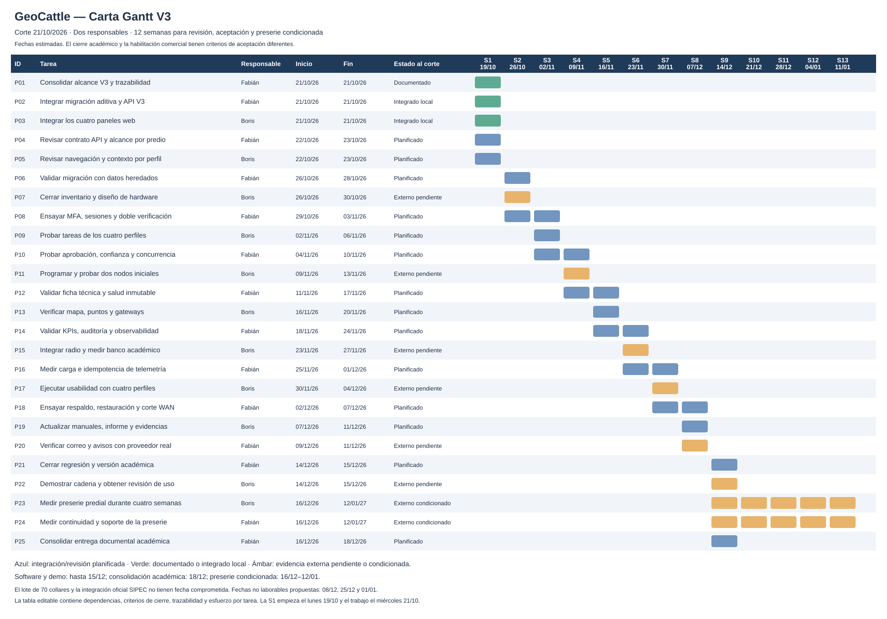

# Carta Gantt GeoCattle V3

Corte: **21 de octubre de 2026**. Esta versión sustituye la planificación relativa de ocho semanas del informe del 4 de octubre. El cronograma ofrece fechas de revisión y aceptación para el alcance V3 y conserva las pruebas físicas como una línea condicionada.

[Plan editable en Excel](Carta_Gantt_GeoCattle_V3_2026-10-21.xlsx).

## Criterios y supuestos

- Dos responsables propuestos: Fabián Del Villar coordina datos/API/seguridad; Boris Baier coordina interfaz, integración IoT y validación. La asignación conserva la distribución del informe y permite revisión cruzada.
- No existe una fecha académica oficial ni disponibilidad predial confirmada en las fuentes. Las fechas son una línea base revisable, no compromisos de terceros.
- Semanas de lunes a domingo. S1 empieza el 19/10; las tareas comienzan el 21/10. La S13 es parcial y muestra el cierre de preserie hasta el 12/01/2027.
- La hoja usa días hábiles de lunes a viernes y tres fechas propuestas sin trabajo: 08/12, 25/12 y 01/01. Confirmar disponibilidad del equipo en fin de año y ajustar las entradas del calendario antes de comprometer terreno.
- Dedicación máxima planificada: 6 horas por persona/día. Los esfuerzos son estimaciones de trabajo futuro, no horas efectivamente ejecutadas por personas o subagentes.
- “Integrado local” indica código presente y comprobaciones locales disponibles. No demuestra carga, cobertura, autonomía ni aceptación del productor.
- Las predecesoras se verifican al generar esta línea base. En Excel se editan inicio/duración/h/día/estado; fin, esfuerzo y barras cambian. Las dependencias deben revisarse al cambiar fechas.
- FMA y eventual intercambio SIPEC siguen siendo P2. Registrar un formulario local no equivale a emitirlo oficialmente. El lote de 70 se programa solo tras aceptar preserie y presupuesto.

## Tareas y dependencias

| ID | Tarea | Responsable propuesto | Inicio | Fin | Predecesoras | Estado al corte | Criterio de cierre |
|---|---|---|---|---|---|---|
| P01 | Consolidar alcance V3 y trazabilidad | Fabián | 2026-10-21 | 2026-10-21 | — | Documentado | 44 RF, 22 RNF y diagramas consistentes |
| P02 | Integrar migración aditiva y API V3 | Fabián | 2026-10-21 | 2026-10-21 | — | Integrado local | Código y migración preservan datos V1 |
| P03 | Integrar los cuatro paneles web | Boris | 2026-10-21 | 2026-10-21 | — | Integrado local | Pantallas conectadas a API según perfil |
| P04 | Revisar contrato API y alcance por predio | Fabián | 2026-10-22 | 2026-10-23 | P01, P02 | Planificado | Denegar IDs ajenos y conservar contexto |
| P05 | Revisar navegación y contexto por perfil | Boris | 2026-10-22 | 2026-10-23 | P01, P03 | Planificado | Cuatro identidades y navegación por permisos |
| P06 | Validar migración con datos heredados | Fabián | 2026-10-26 | 2026-10-28 | P04 | Planificado | Crear desde cero y actualizar copia V1 |
| P07 | Cerrar inventario y diseño de hardware | Boris | 2026-10-26 | 2026-10-30 | P05 | Externo pendiente | BOM, energía, RF y montaje revisados |
| P08 | Ensayar MFA, sesiones y doble verificación | Fabián | 2026-10-29 | 2026-11-03 | P06 | Planificado | TOTP, expiración, replay, suspensión y CSRF |
| P09 | Probar tareas de los cuatro perfiles | Boris | 2026-11-02 | 2026-11-06 | P05 | Planificado | Flujos navegador con dos dueños y colaborador |
| P10 | Probar aprobación, confianza y concurrencia | Fabián | 2026-11-04 | 2026-11-10 | P08 | Planificado | Pendiente sin efecto y aplicación exactamente una vez |
| P11 | Programar y probar dos nodos iniciales | Boris | 2026-11-09 | 2026-11-13 | P07, P09 | Externo pendiente | Lecturas reales y firmware identificado |
| P12 | Validar ficha técnica y salud inmutable | Fabián | 2026-11-11 | 2026-11-17 | P10 | Planificado | Veterinario directo, correcciones y unidades |
| P13 | Verificar mapa, puntos y gateways | Boris | 2026-11-16 | 2026-11-20 | P09, P11 | Planificado | Cuatro vértices, geometría válida y origen visible |
| P14 | Validar KPIs, auditoría y observabilidad | Fabián | 2026-11-18 | 2026-11-24 | P12 | Planificado | Conteos sin duplicados, p95 y auditoría sin secretos |
| P15 | Integrar radio y medir banco académico | Boris | 2026-11-23 | 2026-11-27 | P11, P13 | Externo pendiente | Recepción real, secuencia y recuperación de datos |
| P16 | Medir carga e idempotencia de telemetría | Fabián | 2026-11-25 | 2026-12-01 | P14 | Planificado | 70 nodos, 5 clientes, 10 min y 100 eventos |
| P17 | Ejecutar usabilidad con cuatro perfiles | Boris | 2026-11-30 | 2026-12-04 | P13, P15 | Externo pendiente | Móvil 360 px, tareas y tiempos observados |
| P18 | Ensayar respaldo, restauración y corte WAN | Fabián | 2026-12-02 | 2026-12-07 | P16 | Planificado | RPO/RTO medidos y recuperación de cola |
| P19 | Actualizar manuales, informe y evidencias | Boris | 2026-12-07 | 2026-12-11 | P17 | Planificado | Documentación con alcance real y pendientes |
| P20 | Verificar correo y avisos con proveedor real | Fabián | 2026-12-09 | 2026-12-11 | P18 | Externo pendiente | Enrolamiento entregado, fallos y reintentos |
| P21 | Cerrar regresión y versión académica | Fabián | 2026-12-14 | 2026-12-15 | P06, P08, P10, P12, P14, P16, P18, P20 | Planificado | Sin defectos críticos y evidencia reproducible |
| P22 | Demostrar cadena y obtener revisión de uso | Boris | 2026-12-14 | 2026-12-15 | P15, P17, P19 | Externo pendiente | Nodo real, mapa, evento y dato vencido |
| P23 | Medir preserie predial durante cuatro semanas | Boris | 2026-12-16 | 2027-01-12 | P07, P11, P15, P17, P21, P22 | Externo condicionado | Cobertura, autonomía, seguridad y productor |
| P24 | Medir continuidad y soporte de la preserie | Fabián | 2026-12-16 | 2027-01-12 | P21, P22 | Externo condicionado | Monitor por minuto y ventana mínima de 7 días |
| P25 | Consolidar entrega documental académica | Fabián | 2026-12-16 | 2026-12-18 | P19, P21, P22 | Planificado | Acta académica separada del piloto de campo |

## Hitos

| Hito | Fecha objetivo | Evidencia exigida |
|---|---|---|
| H1 Base V3 integrada localmente | 21/10/2026 | Migración aditiva, API, cuatro paneles y ejecución de comprobaciones locales documentadas. |
| H2 Versión académica verificada | 15/12/2026 | Regresión, MFA, aislamiento, aprobación, ficha sanitaria, carga, restauración y demo real. |
| H3 Entrega documental académica | 18/12/2026 | Informe, Gantt, manual, inventario y resultados distinguiendo pendiente/ejecutado. |
| H4 Preserie aceptada | 12/01/2027 condicionado | Cuatro semanas de campaña, cobertura/autonomía/continuidad/montaje y acta del productor. |
| H5 Habilitación de 70 collares | Sin fecha | H4 aprobado, costo revisado, fabricación, instalación y capacitación. |

## Fuentes

- Informe más reciente: `Entregables_GeoCattle_2026-10-04/Informe_2_GeoCattle_con_Viabilidad_y_Flujo_Caja_2026-10-04.docx`, sección “VII Cronograma ajustado y organización”, tabla de encabezados “Fase / Semanas / Dependencia y entrega / Responsable”.
- `docs/especificacion-v3/00_ANALISIS_Y_ALCANCE.md`, `01_CASOS_DE_USO.md` y `02_REQUERIMIENTOS.md`.
- Decisión confirmada por el usuario: veterinario con cambios directos; trabajador con aprobación salvo confianza por acción.

La evidencia exacta de implementación se mantiene en `EVIDENCIA_IMPLEMENTACION.md` y en `actualizacion_informe.md` de la raíz del proyecto.
